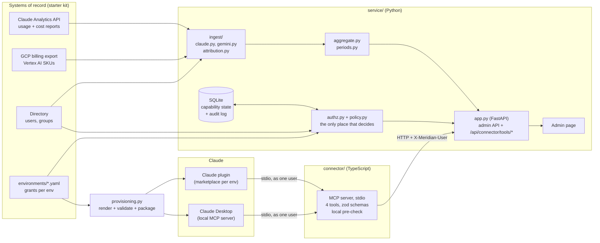

# Meridian AI usage

A small service that takes Claude and Gemini usage exports, turns them into one model, and lets a team lead ask “how much did my team use last month?” from inside Claude — and only see their own team.

**Assignment ID:** Fullstack-ClaudeGemini-UsageConnector-v1

| Part | What | Where |
|------|------|-------|
| A | Ingestion, aggregation, permissions, REST API, admin page (Python / FastAPI) | `service/` |
| B | MCP server with four scoped tools (TypeScript) | `connector/` |
| B | Permissions manifest + plugin registration, validated | `provisioning/` |
| B | Demo recording and transcript | `docs/demo-transcript.md`, `docs/demo-recording.mov` |
| B | Note to team leads | `docs/note-to-team-leads.md` |

## Quick start

Needs `uv` and Node 20+. `uv` pulls Python 3.13 itself.

```bash
make setup          # deps from the lockfiles
make check          # lint, types, 255 Python + 28 connector tests, provisioning check
make serve ENV=prod # admin page + API on http://127.0.0.1:8002 (dev :8000, staging :8001)
```

In the admin page the “Acting as” switcher picks the simulated caller. Try Chloe Dubois (platform admin), Priya Nair (team lead) and Daniel Okafor (member) in prod.

To use it from Claude Desktop (macOS) while `make serve ENV=prod` is running:

```bash
make install-desktop-preview ENV=prod   # shows the entry, writes nothing
make install-desktop ENV=prod           # backs up claude_desktop_config.json, adds the server
# Quit Claude Desktop (Cmd+Q) and reopen. Settings > Developer should show meridian-usage: Running.
```

It registers as Priya Nair by default. `WHO=chloe.dubois@meridianls.example` acts as an admin.

Other commands: `make provision` re-renders `provisioning/rendered/`, `make package` builds the plugin marketplace in `dist/marketplace/`, `make demo` regenerates the transcript.

## Architecture



When Claude calls `usage_summary`, the MCP server is already running as a specific user. It checks the tool input against the contract, does a quick local scope check, then calls the service. The service checks again (who is calling, whether the connector is on for their group, whether they have the scope, and whether they can see that group) and only then aggregates. A refusal comes back as the contract’s Denial shape and contains no data.

Python is used for the service because most of the work is data mapping and policy. TypeScript is used for the connector because the MCP TypeScript SDK is the reference implementation. They only meet at one HTTP endpoint, so neither has to re-implement the other’s logic.

## Mapping decisions

Both exports become `UsageRecord`: one user’s use of one model through one product on one UTC day, with input and output tokens, cost as an exact `Decimal` in dollars, and the user and group it belongs to. Anything a platform doesn’t report is `null`, not `0`.

| | Claude export | Gemini export | Decision |
|---|---|---|---|
| Grain | user × day × product × model; cost adds × cost_type | project × day × SKU, owner/agent labels | One record per user × day × product × model. Gemini input and output SKU rows are folded together. |
| Input tokens | uncached + cache read + cache write 5m + 1h | Input SKU | Claude cache tokens count as input, so input + output = total_tokens on both. Cache split is kept in its own fields. |
| Cost | decimal string in cents | float USD after credits | `Decimal(cents) / 100`; `Decimal(str(float))`; no float arithmetic. Rounded to micro-dollars only when serialised. |
| Claude cost | tokens + web_search rows | — | Both summed onto the usage key; web search is 1¢ per search. |
| Time | RFC 3339 …T00:00:00.000Z | BigQuery … 00:00:00 UTC | Both become a UTC date; one-day buckets are checked. Months use usage date, not invoice.month. |
| Product | chat / claude_code / cowork | agent label | Stored as product. |
| Requests | reported | not available | `null` for Gemini. |

The user comes from `actor.user_id` (Claude) or the owner label (Gemini, case-insensitive). The group comes from the platform’s own identifier — the Claude RBAC group or the GCP project — because that’s where the usage ran and who pays for it. It has to match the directory (the user must belong to that group). If it doesn’t, the row is rejected with a reason. It is never moved to another team. Unknown users, projects or groups are rejected the same way. `/api/ingest/report` lists rejections and warnings.

A Claude usage row without a cost row is kept at $0 with a warning. A cost row without usage is kept with 0 tokens and a warning. If a usage row is rejected, its cost is rejected with it.

This dataset is clean. Every row attributes, totals reconcile (Claude $2,830.29, Gemini $287.84), and nothing is rejected. The checks exist for real exports. The reconciliation tests recompute totals from the raw files independently of the parsers, so a scaling, dropping or double-counting bug fails them. I checked that by breaking the code on purpose.

Periods are half-open UTC ranges. `last_7_days` and `last_30_days` count back from 2026-09-28 (the end of the data) so answers are reproducible. Every answer says how much of the period the data covers: 2026-08 starts on the 3rd, 2026-09 stops on the 27th.

A couple of small things: `it-platform` has a Gemini agent called `usage-connector-dev` (the connector’s own development shows up as spend). Gemini billing lands with a few hours’ lag.

## Permission model

Roles → scopes, per environment, from `starter-kit/environments/<env>.yaml`:

| | dev | staging | prod |
|---|---|---|---|
| `usage:read` | member, team_lead, platform_admin | team_lead, platform_admin | team_lead, platform_admin |
| groups visible | any | own (admins: all) | own (admins: all) |
| `capabilities:write` | team_lead, platform_admin | team_lead, platform_admin | platform_admin |
| usage-connector default | on | on | it-platform, clinical-operations only |

The rendered per-person version is in `provisioning/rendered/<env>/PERMISSIONS.md`.

Every connector call passes four checks, in this order, and stops at the first failure:

1. The caller is a known user in the directory.
2. The connector is enabled for the caller’s group (the Part A capability switch).
3. The caller’s role holds the tool’s scope in this environment.
4. The caller can see the group (their own, or any for admins or in dev). Changing a capability needs `capabilities:write` and visibility of the target group — you can only change what you can see.

This is enforced in `service/src/meridian_usage/authz.py` and nowhere else decides. The MCP server repeats checks 3 and 4 from the user’s resolved permissions as a fast first refusal, but the service re-checks everything on every call. The end-to-end test gives the connector a forged belief that a team lead is an admin, and the service still refuses. The connector switch is never cached in the connector because an admin can flip it at any time.

A scope with no roles listed is granted to nobody. A group with no stored capability row is treated as disabled. The policy loader rejects unknown keys, roles, scopes and groups, so a typo like `team_leader` fails to load instead of quietly changing access.

No tool takes a user, role or scope argument. Identity is fixed when the server starts (`MERIDIAN_USER`). Arguments like `as_user` or `role` are dropped by the input schema (tested). A prompt can change what is asked, not who is asking.

Refusals use the contract’s Denial shape (`error`, `reason`, `required_scope` where it helps) and are tested to contain nothing else. Malformed input is a different error (`invalid_argument`), and a refusal is returned before any input hint, so a caller who may not read a group cannot probe it.

Capability toggles live in SQLite (one file per environment, under `var/`). Environment defaults are applied on first start and never overwrite a later decision. Every change, including the defaults, goes to an append-only audit log with who and when, shown on the admin page.

## Platform: Claude

Ran on: macOS [VERSION], Apple silicon; Claude Desktop [VERSION]; Node 24.20; Python 3.13 via uv. [Fill in from “About Claude” and `sw_vers`.]

`make install-desktop` renders an `mcpServers` entry into `claude_desktop_config.json` with absolute paths to node and the bundled connector (Claude Desktop does not inherit your shell’s PATH, so a bare `node` fails with nvm). It merges, keeping other servers and settings, and backs the file up first.

`make package` builds `dist/marketplace/`, a plugin marketplace (`.claude-plugin/marketplace.json`) with one plugin per environment. Each plugin has `.claude-plugin/plugin.json`, a `.mcp.json` that starts `${CLAUDE_PLUGIN_ROOT}/server/index.mjs`, and the connector bundled into that one file by esbuild, so the plugin needs no `node_modules`. The user’s identity is a `userConfig` value (`${user_config.user_email}`) prompted for when the plugin is enabled.

```bash
claude plugin marketplace add ./dist/marketplace
claude plugin install meridian-usage@meridian-it
```

The plugin files are validated in CI by checks that mirror `claude plugin validate` (reserved names, strict `userConfig` keys, undeclared `${user_config.*}` references, entry via `${CLAUDE_PLUGIN_ROOT}`). [If you ran `claude plugin validate dist/marketplace`, say so and paste the result.]

Three layers decide what a person can do through this connector. First, distribution: an organisation publishes plugins through a marketplace, and administrators control which marketplaces users may add (`strictKnownMarketplaces`) and which plugins are on by default, so a connector reaches only the people it is meant for. Second, the tool surface: an MCP server declares its tools, and the model can only call those, with inputs validated against their schemas. Here the list is fixed by the server and none of the tools accepts an identity, so the prompt cannot widen it. Third, the data behind each tool, which the service scopes by role and group. Claude Enterprise also syncs groups from the identity provider into its own RBAC groups (the `rbac_group_id` on every Claude row). Those are what the platform uses to grant product access, and they are what this service attributes Claude usage to.

Usage data comes from the Claude Enterprise Analytics API (`/v1/organizations/analytics/user_usage_report` and `user_cost_report`), per user per day, grouped by product and model. The starter kit is those responses with pages concatenated.

The demo is in `docs/demo-recording.mov` (the three cases in Claude Desktop as Priya Nair). `docs/demo-transcript.md` is the same three cases, generated by `make demo` by an MCP client that starts the bundled server over stdio exactly as Claude Desktop does: an allowed read, a refused cross-group read, a refused write.

## Provisioning

```bash
make provision         # writes provisioning/rendered/<env>/
make provision-check   # what CI runs: validate, and fail if anything committed is stale
```

Per environment it renders `permissions.json` (schema-validated), `PERMISSIONS.md` (the same for people) and the plugin registration (`plugin.json`, `.mcp.json`). Inputs are the environment YAML, `provisioning/hosts.yaml` (service URL per environment) and the tool contract. It uses the service’s own policy parser, and a test checks every person’s rendered access against what the running service enforces, so the manifest cannot drift from the rules.

Guardrails reject unsafe policy whatever the YAML says: members never write; visibility is own-group outside dev; only admins write in prod; members cannot read outside dev; code execution defaults to off in prod; every environment has its own server name. Each has a test that feeds in the violation.

Nothing is hand-edited. Output is deterministic (no timestamps), and `provision-check` re-renders and fails on any difference or any extra file. The Claude Desktop entry is the one exception: it needs absolute paths and the user’s identity, so it is rendered at install time by the same code rather than committed.

CI (`.github/workflows/ci.yml`) installs from the lockfiles only, then runs lint, type checks, all tests (including the end-to-end MCP test, which starts the real service), the provisioning check, the build and the packaging. I used a script instead of Terraform because there is no real infrastructure here, and the rendering logic is easier to test in Python.

## Key decisions

- Policy is decided in one place. Every allow or deny comes from `authz.py`. The connector repeats the cheap checks so it can refuse fast, but it is not a second source of truth.
- Framework-free core. Ingestion, aggregation and authorisation are plain Python with no FastAPI imports. `app.py` only maps requests to them. The logic is tested without HTTP, and the HTTP layer gets its own small set of status-code tests.
- Exact money. Costs are `Decimal` from the moment they are parsed and are rounded only when serialised.
- Reject, don’t reassign. When a row’s platform group disagrees with the directory, the row is rejected with a reason. Quietly moving spend from one team to another is the worst thing a cost report can do.
- Periods anchored to the data. “Last 7 days” counts back from the end of the export, not from today, so the same question gives the same answer next week.
- In memory, with SQLite only where state must persist. About 1,800 records fit in memory and aggregate in milliseconds. Capability controls must survive restarts and need an audit trail, so they are in SQLite.
- Identity fixed at start-up. The connector resolves who it is acting for once, from the directory, and refuses to start for an unknown user. No tool takes a user or role.
- One bundled file for the plugin. esbuild packs the connector and its dependencies into `index.mjs`, so the plugin works without an install step.

## Engineering standards

Followed: strict typing on both sides (mypy strict, TypeScript strict with `noUncheckedIndexedAccess` and `exactOptionalPropertyTypes`), ruff for lint and formatting, tests at three levels (unit tests per mapping and permission rule, reconciliation tests that recompute totals from the raw files, and an end-to-end test that runs the real service and talks to the real MCP server). While building I broke code on purpose (cents divided by 10, cache tokens dropped, the group check removed, the visibility check removed) to confirm the tests fail. Response shapes are checked against the starter kit’s `tools.schema.json`. Installs use lockfiles (`uv sync --locked`, `npm ci`) in CI. Generated files are never hand-edited, and CI proves it. Small commits, one step each.

Skipped on purpose: no TypeScript linter beyond the compiler, no coverage threshold, no structured logging or metrics, authentication is a simulated header (as the brief allows), SQLite has no migration tool (two tables), the admin page has no automated front-end tests (checked by hand as each role). The test client’s `StarletteDeprecationWarning` about httpx is left visible rather than silenced.

## How I used AI tools

I used Claude to help plan and suggest approaches as I went. I worked through the project in steps — data, scaffold, ingestion, aggregation, permissions, API and page, connector, provisioning, packaging, and writing — and for each one I asked for a direction, then implemented and checked it myself with make check before continuing.
The main design choices were mine: Python for the service and TypeScript for the connector, Claude as the host, rejecting mismatched rows instead of reassigning them, and testing the permission rules first. I also verified a few numbers against the raw files (September clinical-operations usage matched at $77.67).
I caught a few issues that only showed up on my machine (wrong file locations, a formatting failure, Python 3.15 being selected by default, a Makefile variable that conflicted with Make’s built-in AS, and TypeScript config that didn’t cover the demo script). Some suggestions arrived untested because FastAPI and the MCP SDK couldn’t be installed in that environment, so I only trusted what passed locally. I reviewed the authz and attribution code myself rather than taking it as-is.

## What I would do differently with more time

- Replace the simulated header with a signed token the service validates, and run the connector as a remote MCP server with OAuth so nothing holds an email.
- Package for Claude Desktop as an extension (`.mcpb`) as well as a plugin, so a non-technical user installs it with a double-click.
- Gemini CLI as well. The service and permission model are platform-neutral; only the packaging is Claude-specific.
- Live ingestion. Pull from the APIs on a schedule into a database, incrementally and idempotently.
- Read auditing and rate limits. Writes are audited today; reads of other teams’ data by admins should be too.
- A TypeScript linter, front-end tests for the admin page, and moving the test client off the deprecated httpx path.

## In a real enterprise version

The connector would not be started “as” someone. The host would sign the user in through the company’s SSO, and the connector would receive a token for that person. The service would validate it and read their groups and role from the token claims or from SCIM, not from a JSON file. Group changes would take effect on the next request, with nothing to reinstall, and leaving the company would remove access everywhere at once. The connector would be a remote MCP server with OAuth rather than a local process holding an email address.

Instead of a local marketplace folder, IT would publish the connector to an organisation-managed marketplace. Administrators would allowlist it, pin versions and roll out updates. Who gets the connector would be decided from the same place as the capability switches in this service, so “enable the usage connector for Regulatory Affairs” would be one decision, not two.

Ingestion would become a scheduled job: the Claude Enterprise Analytics API with an admin key, following pagination and recording `data_refreshed_at`, and the BigQuery billing export queried incrementally by `export_time`. Both writes would be idempotent upserts on the same keys this model uses, because billing rows arrive late and get restated. Reports would need to state how fresh each source is. Currency, list versus net price, and committed-use discounts would need explicit handling.

Usage would go into a proper database with the aggregation queries pushed down to it. The service would run behind the company gateway with secrets in a vault. Terraform would manage the three environments, and the provisioning check here would become a policy gate in CI: an unsafe grant would fail the pipeline before it could be applied. Ingestion rejections would raise alerts instead of only appearing in a report, and the capability audit log would go to the security team’s log system.

---

This keeps the structure and the facts, but the voice is a bit flatter and more direct. Fill in the macOS / Claude Desktop versions, and if you ran `claude plugin validate`, add that sentence.
